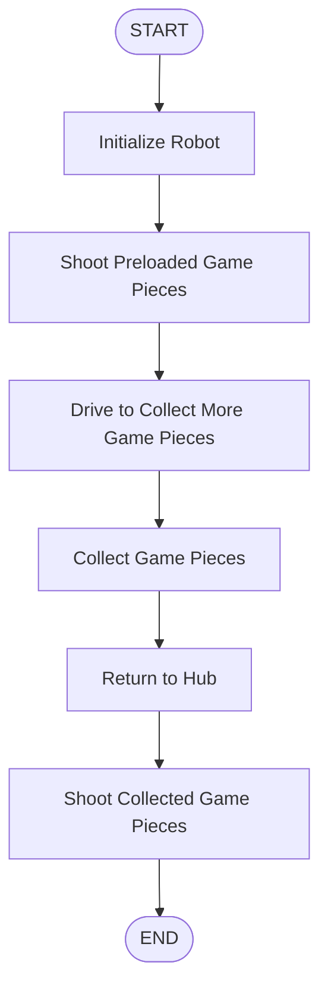

## Flowchart

## Autonomous States

| State | Description |
|---|---|
| START | Initialize robot |
| SHOOT_PRELOAD | Shoot preloaded game pieces |
| DRIVE_TO_COLLECT | Drive toward collection area |
| COLLECT | Collect game pieces |
| RETURN_TO_HUB | Return to the Hub |
| SHOOT_AGAIN | Shoot collected game pieces |
| DONE | End autonomous |

## Development Notes

- Autonomous time limit: 20 seconds
- Initial goal: Complete one collection and shooting cycle.
- Test each movement and mechanism separately before combining them.
- Record changes and improvements as the autonomous routine develops.

